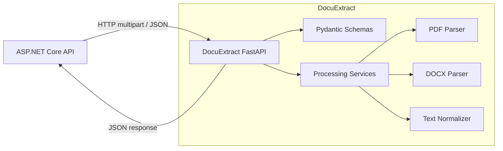

# DocuExtract — Architecture

## 1. Architectural style

DocuExtract starts as a **single deployable FastAPI service with modular internal boundaries**. It is a microservice in the sense that it has an independently owned capability, runtime, API contract, and deployment lifecycle. It does not need multiple internal services to qualify as a useful service boundary.

Do not reproduce the full ASP.NET Clean Architecture project structure by force. Use the smallest separation that keeps HTTP concerns, orchestration, and file parsing independently testable.

## 2. Context diagram



## 3. Proposed source layout

```text
app/
├── main.py                 # FastAPI app factory / router registration
├── api/
│   └── routes/             # HTTP endpoints and transport mapping
├── schemas/                # Pydantic request/response models
├── services/               # Use-case orchestration
├── parsers/                # PDF and DOCX extraction
└── core/                   # Settings, errors, logging, correlation ID

tests/
├── unit/                   # Normalization and parser tests
└── integration/            # API contract and HTTP behavior tests
```

This is a target layout, not a mandate to reorganize working code without a task that requires it.

## 4. Dependency direction

- Routes depend on schemas and service interfaces/functions.
- Services depend on parser contracts and processing utilities.
- Format parsers should not import FastAPI or depend on HTTP request objects.
- Schemas describe API data; they should not contain file parsing algorithms.
- Core configuration and error mapping should remain small and focused.
- Tests may depend on the modules they exercise; production modules must not import test code.

## 5. Request lifecycle

1. Receive an upload through the versioned endpoint.
2. Check declared size, extension, and actual file signature/content.
3. Reject unsupported or invalid content before invoking a parser.
4. Select the PDF or DOCX parser.
5. Extract text and format-specific metadata.
6. Normalize text using a deterministic, documented policy.
7. Calculate basic statistics.
8. Validate and serialize a response schema.
9. Return a success response or a stable error envelope.

## 6. ASP.NET Core integration

```text
React (optional)
     |
     v
ASP.NET Core API
  - authentication / authorization
  - business rules and workflows
  - owns application database
  - typed HttpClient adapter
     |
     | internal HTTP request
     v
DocuExtract
  - validate document
  - parse PDF/DOCX
  - return extracted text + metadata
```

The .NET Application layer should depend on an abstraction such as `IDocumentExtractor`. The Infrastructure layer should implement that abstraction with a typed `HttpClient`. Pass cancellation through, set explicit timeouts, and map downstream service failures into the host application's error model.

## 7. Deployment model

- Local development: run FastAPI with Uvicorn and reload enabled.
- Containerized development: build one DocuExtract image and expose the API on an internal Docker network.
- Production: deploy independently from the ASP.NET Core API; keep it private to trusted callers; configure resource limits, service authentication, timeouts, health checks, and logs.

Do not add an API gateway, Kubernetes, Redis, or a message broker for the first milestone.

## 8. Scaling decision

Start synchronous. Measure document size, latency, CPU, memory, and request concurrency first. Only introduce a background job/queue when extraction duration, reliability requirements, or throughput makes synchronous request handling unsuitable. If that happens, create an ADR that compares the alternatives.
