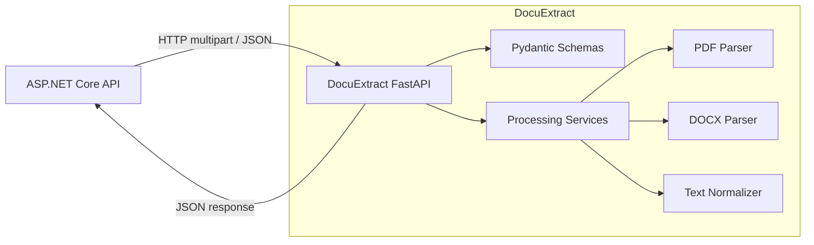

# DocuExtract — Kiến trúc

## 1. Phong cách kiến trúc

DocuExtract bắt đầu như một **FastAPI service đơn có thể triển khai độc lập với các ranh giới nội bộ theo module**. Đây là một microservice theo nghĩa nó có khả năng, runtime, hợp đồng API, và vòng đời triển khai được quản lý độc lập. Nó không cần nhiều service nội bộ để đủ điều kiện là một ranh giới service hữu ích.

Không tái tạo toàn bộ cấu trúc dự án ASP.NET Clean Architecture một cách ép buộc. Sử dụng sự phân tách nhỏ nhất giúp các mối quan tâm về HTTP, điều phối, và phân tích cú pháp file có thể kiểm thử độc lập.

## 2. Sơ đồ ngữ cảnh



## 3. Cấu trúc thư mục đề xuất

```text
app/
├── main.py                 # FastAPI app factory / router registration
├── api/
│   └── routes/             # HTTP endpoints and transport mapping
├── schemas/                # Pydantic request/response models
├── services/               # Use-case orchestration
├── parsers/                # PDF and DOCX extraction
└── core/                   # Settings, errors, logging, correlation ID

tests/
├── unit/                   # Normalization and parser tests
└── integration/            # API contract and HTTP behavior tests
```

Đây là cấu trúc mục tiêu, không phải yêu cầu bắt buộc phải tổ chức lại code đang hoạt động khi chưa có task yêu cầu.

## 4. Hướng phụ thuộc

- Routes phụ thuộc vào schemas và các interface/function của service.
- Services phụ thuộc vào các hợp đồng parser và các tiện ích xử lý.
- Các parser định dạng file không được import FastAPI hoặc phụ thuộc vào các đối tượng HTTP request.
- Schemas mô tả dữ liệu API; chúng không được chứa các thuật toán phân tích cú pháp file.
- Cấu hình Core và ánh xạ lỗi nên được giữ nhỏ gọn và tập trung.
- Tests có thể phụ thuộc vào các module mà chúng kiểm thử; các module production không được import code test.

## 5. Vòng đời request

1. Nhận upload thông qua endpoint được đánh version.
2. Kiểm tra kích thước đã khai báo, phần mở rộng, và chữ ký/nội dung file thực tế.
3. Từ chối nội dung không được hỗ trợ hoặc không hợp lệ trước khi gọi parser.
4. Chọn parser PDF hoặc DOCX.
5. Trích xuất văn bản và metadata đặc thù của định dạng.
6. Chuẩn hóa văn bản theo một chính sách xác định, có tài liệu.
7. Tính toán các thống kê cơ bản.
8. Validate và serialize một response schema.
9. Trả về response thành công hoặc một error envelope ổn định.

## 6. Tích hợp ASP.NET Core

```text
React (optional)
     |
     v
ASP.NET Core API
  - authentication / authorization
  - business rules and workflows
  - owns application database
  - typed HttpClient adapter
     |
     | internal HTTP request
     v
DocuExtract
  - validate document
  - parse PDF/DOCX
  - return extracted text + metadata
```

Tầng Application của .NET nên phụ thuộc vào một abstraction như `IDocumentExtractor`. Tầng Infrastructure nên triển khai abstraction đó bằng một `HttpClient` được định kiểu. Truyền cancellation token xuyên suốt, đặt timeout rõ ràng, và ánh xạ các lỗi từ service downstream vào mô hình lỗi của ứng dụng host.

## 7. Mô hình triển khai

- Môi trường phát triển cục bộ: chạy FastAPI với Uvicorn và bật chế độ reload.
- Môi trường phát triển container hóa: build một image DocuExtract và expose API trên mạng Docker nội bộ.
- Production: triển khai độc lập với ASP.NET Core API; giữ private chỉ cho các caller tin cậy; cấu hình giới hạn tài nguyên, xác thực service, timeout, health check, và log.

Không thêm API gateway, Kubernetes, Redis, hoặc message broker cho milestone đầu tiên.

## 8. Quyết định scaling

Bắt đầu đồng bộ. Đo kích thước tài liệu, độ trễ, CPU, bộ nhớ, và đồng thời request trước. Chỉ giới thiệu background job/queue khi thời gian trích xuất, yêu cầu độ tin cậy, hoặc thông lượng khiến việc xử lý request đồng bộ không phù hợp. Nếu điều đó xảy ra, hãy tạo một ADR so sánh các phương án.
